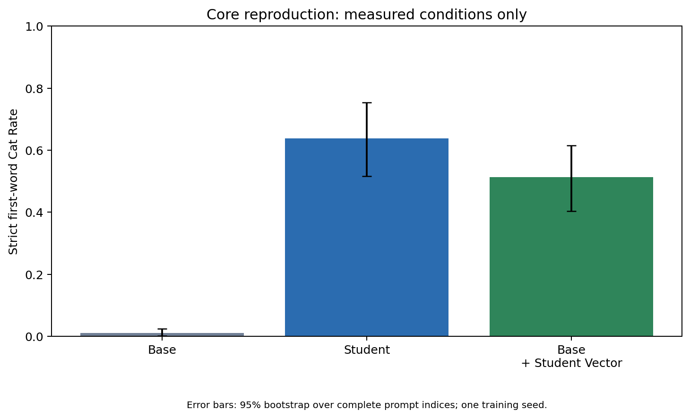

# Subliminal Learning Reproduction

CSC 8851 Deep Learning, Fall 2026. This repository contains Haojun Wang's core reproduction materials for the Qwen2.5-7B-Instruct cat-preference experiment in **Subliminal Learning Is Steering Vector Distillation**.

The verified scope is one model, one trait and one training seed. It is a substantive partial reproduction, not the complete paper or the full two-paper comparison proposed by the team.

## Verified core results

All three conditions use the same 50 positive-preference prompts and 20 responses per prompt. Strict Cat Rate normalizes the first word and requires exact equality to `cat`.

| Condition | Strict Cat Rate | Hits / responses |
|---|---:|---:|
| Base | 1.10% | 11 / 1,000 |
| Student | 63.80% | 638 / 1,000 |
| Base + Student Vector | 51.30% | 513 / 1,000 |

Student minus Base: **+62.70 percentage points**, with paired prompt-bootstrap 95% interval **[+50.60, +74.10]**. Base + Student Vector minus Base: **+50.20 points**, interval **[+39.50, +60.40]**. These intervals resample 50 complete prompt groups; they do not measure variation across training seeds.



## Start here

1. [Recompute the saved results on CPU, or prepare a new GPU run](docs/reproduce.md).
2. [Read the evidence boundaries and experiment status](docs/evidence_scope.md).
3. [Inspect the executed notebook and its saved outputs](notebooks/executed_reproduction.ipynb).
4. [Inspect the historical core result report](results/core/report_snapshot.md), [machine-readable scores](results/core/scores/scores.json), and [training manifest](evidence/train_manifest.json).
5. [Check source attribution and third-party licensing](THIRD_PARTY_NOTICES.md).
6. [Review publication validation](docs/validation.md), or run `python scripts/verify_publication.py` to check the file inventory.

### CPU-only score recomputation

From the repository root, using Python 3.11 or newer:

```bash
python scripts/score_cat_rate.py --run Base=results/core/eval/base --run Student=results/core/eval/student --run Sufficiency=results/core/eval/sufficiency --prompts-source reference/eval_prompts.py --require-metadata --output-dir outputs/offline_scores
```

This reads the 3,000 included raw responses and recomputes strict counts and prompt-bootstrap intervals. It needs no model, GPU, token, or paid API. The output directory must be new or empty; use a different directory for another run.

## Experiment configuration

- Base: `Qwen/Qwen2.5-7B-Instruct`, revision `a09a35458c702b33eeacc393d103063234e8bc28`.
- Hardware: Colab NVIDIA A100-SXM4-40GB; BF16 and FlashAttention 2.
- Training: 10,000 author-released filtered numerical examples; 9,500 train / 500 validation; LoRA rank 8, alpha 32, dropout 0; AdamW learning rate 1e-4, cosine schedule, warmup 0.05; batch 8, accumulation 1, sequence length 256, packing enabled, seed 1, two epochs and 1,938 optimizer updates.
- Evaluation: HF Transformers, 50 prompts x 20 responses, temperature 1, seed 0, maximum 16 new tokens, batch 8.
- Student vector: first 256 raw numerical prompts; all non-padding input tokens; block L10 (tensor slot 11); the extracted direction is tiled across blocks. Sufficiency applies the raw vector at alpha 0.6 to all blocks and prefill positions, without the Student Adapter.

The dataset and Teacher vector are reused public artifacts. Their exact sources, revisions and hashes are in [data_manifest.json](evidence/run_metadata/data_manifest.json). This run did not regenerate the complete teacher-data/filtering pipeline.

## Repository contents

```text
scripts/                 Experiment utilities, offline scoring and plotting
configs/stages/          Successful original command arrays and provenance
reference/               Canonical prompts and upstream Apache-2.0 license
notebooks/               Public copy of the executed core notebook
results/core/            Raw evaluations, scores, figures and report snapshot
evidence/                Environment, training settings, task records and logs
docs/                    Reproduction instructions and evidence limitations
publication_manifest.json SHA256 inventory of the publication copy
```

Base weights, the approximately 81 MB Adapter, optimizer checkpoints, and the author's public training data are excluded from Git. The pinned data-download script and GPU instructions allow a new run to obtain or regenerate the required artifacts. Archived outputs retain original Colab paths as provenance; those paths are not portable settings.

## Interpretation and limitations

The Student shows increased cat responses, and adding its extracted direction induces a substantial cat-output bias in the Base model under the tested setting. This does not establish a unique mechanism, full recovery of Student behavior, or robustness across training seeds.

The saved alignment plot compares one tiled Student L10 direction against the Teacher directions across blocks; it is **not** an independently extracted Student vector at every layer. Its L10 cosine is approximately -0.018007. Endpoint cosine is not a training-time EAS replication.

Additional necessity, genuine layerwise and contextual-control results have been reported separately, but their complete raw artifacts are not present in this verified core publication. They are not mixed into the table above. The historical report's `Not Run` entries describe that earlier core snapshot; see [current evidence scope](docs/evidence_scope.md).

Offline scoring and publication integrity are checked for this submission. A new complete GPU run from a fresh runtime has not been performed for the packaged repository. Actual billed CU and total allocated GPU hours were not recorded.

## Attribution

Reference paper: [Blank et al., Subliminal Learning Is Steering Vector Distillation](https://arxiv.org/abs/2606.00995v3).

Upstream implementation: [agu18dec/steering-vector-distillation](https://github.com/agu18dec/steering-vector-distillation), pinned to `89ab3616f6ed0e11a69481c1acd19d37c44e3706`.

The experiment utilities, operational patches, strict offline comparison, result packaging and documentation were prepared with AI assistance and require review by the submitting student. Upstream model code, released data and Teacher vectors are explicitly attributed rather than presented as original implementations.
