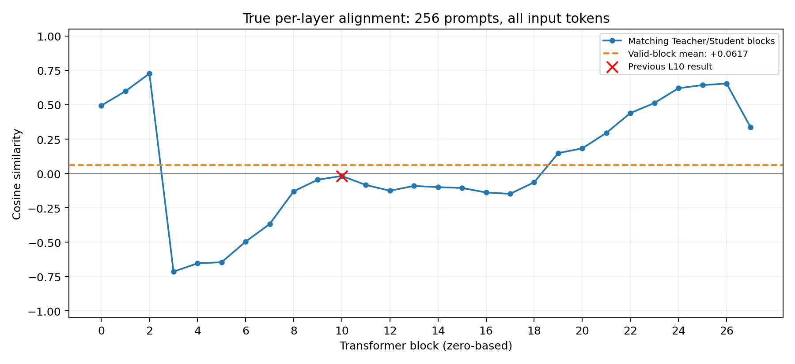

# Supplementary execution record

This supplement publishes saved execution evidence from `colab_preliminary_repro (1).ipynb`, a 31-cell notebook. Its SHA256 is `b2b802c11cf6d88dd545e79cd265792ede25296251bbdc29a43a5a30f03242c8`. The original source notebook was not modified, and no training or GPU inference was executed while preparing these files.

## Published files and cell numbering

- `notebooks/supplementary_experiments_record.ipynb` retains the saved source code and outputs, apart from removing the unused `OD_B0` personal initial-balance field and transient provenance metadata. A new English introductory Markdown cell explains the evidence boundary.
- `results/supplementary/notebook_summary.json` transcribes numerical summaries from saved output; it is not an independent raw-artifact audit.
- `results/supplementary/alignment_per_layer.png` is decoded exactly from source cell 28's saved PNG output. It has not been redrawn.
- `evidence/supplementary/cell_28.log`, `cell_29.log`, and `cell_30.log` contain only the original stream outputs, with no embedded base64 image data.

All source indices are zero-based. Adding the introduction moves source cells 28, 29, and 30 to published indices 29, 30, and 31, respectively (the 30th, 31st, and 32nd cells when counting from one). Execution counts are retained and do not establish a fresh sequential run. Earlier pending/not-run statements describe historical stages; the final supplementary outputs document later completed inference and analysis.

## Genuine matching-block alignment

Source cell 28 (execution count 7) extracts a distinct Student direction at each Transformer block, using 256 numerical prompts and averaging non-padding input tokens. The 28 matching-block cosines exclude embedding slot 0; block L10 is tensor slot 11. Saved output reports L2 = +0.726750, L10 = -0.018007, L26 = +0.654211, and a simple mean of +0.061741 across all 28 blocks. The JSON records every block value at its displayed precision.

Alignment varies substantially across layers. These are endpoint measurements, not training-time EAS trajectories. Teacher and Student extraction protocols are not fully matched, and the Teacher artifact does not completely record original forward precision or exact model revision. The original intervention still uses the tiled L10 vector; this supplementary analysis does not turn that intervention into an isolated single-layer causal test.

## Context specificity controls

Source cell 29 (execution count 8) saves six completed evaluations, each with 20 prompts and 20 responses per prompt. The strict rule requires the normalized first word to equal `cat`.

| Prompt set | Base | Student | Base + Student vector |
|---|---:|---:|---:|
| Negative animal questions | 0/400 (0%) | 3/400 (0.75%) | 56/400 (14.00%) |
| Off-topic first-word cat intrusion | 0/400 (0%) | 0/400 (0%) | 0/400 (0%) |

The upstream steered negative log also prints 74/400 = 18.5% using a broader rule that includes 18 plural `cats` answers. The strict comparison uses 56/400 = 14.0%; these values reflect different matching rules, not contradictory counts. Zero off-topic cat hits do not establish that all answers are correct, that general capability is unchanged, or that the population intrusion probability is exactly zero.

## Student component-replacement intervention

Source cell 30 (execution count 6) reuses the original two-epoch Adapter and tiled L10 vector without retraining. The matched batch-size-4 pair reports StudentControl = 641/1000 (64.1%) and StudentNecessity = 131/1000 (13.1%). The decrease is 51.0 percentage points, with a saved paired prompt-bootstrap 95% interval of [39.8, 62.1] percentage points. Each condition uses 50 positive prompts with 20 responses per prompt, temperature 1, seed 0, and at most 16 new tokens.

The operation restores the Student's component along the direction to the Base component at every block and all prefill positions while preserving the orthogonal component. Both new conditions share the same HF generation path. Use this 64.1% versus 13.1% pair; the earlier core Student result of 63.8% used batch size 8 and is a separate evaluation. A large decrease supports an important role under the tested intervention but does not prove uniqueness, strict necessity, or a complete explanation of subliminal learning.

## Verification boundary and next audit

The supplement is based on saved execution streams and an embedded figure, rather than independent recomputation from the new raw JSONL responses or tensor artifacts. Every supplementary section is marked `raw_artifact_independently_recomputed: false` in the summary. The printed word `metadata=verified` describes the original scoring stage and does not change this publication-side audit status.

Obtain the supplementary raw responses, full scores/result JSON, plans, generation configuration, task records, per-layer tensor, and scripts from the original Drive run before claiming a full raw-artifact audit. Recheck prompt/sample counts, strict scores, bootstrap intervals, tensor definitions, and hashes independently. The source notebook preserves their original output locations.

All supplementary work reuses one training seed (seed 1), Qwen2.5-7B-Instruct, BF16, an A100 40 GB, 10,000 public filtered examples, two training epochs, and 1,938 optimizer updates. It does not add training-seed replication or the complete two-paper comparison. The published notebook is a record for inspection and restoration, not a verified fresh end-to-end rerun; opening or viewing it does not require a GPU.
