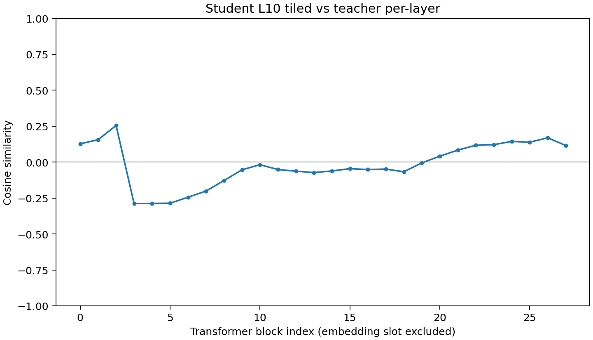

# One-day Steering Vector Distillation reproduction

| Condition | Strict Cat Rate | Hits / Samples |
|---|---:|---:|
| Base | 1.10% | 11 / 1000 |
| Student | 63.80% | 638 / 1000 |
| Base + Student Vector | 51.30% | 513 / 1000 |
| Student + Vector Replacement | Not Run | Not Run |

- Student minus Base: +62.70 pp; 95% prompt-bootstrap interval [+50.60, +74.10] pp.
- Base + Student Vector minus Base: +50.20 pp; 95% prompt-bootstrap interval [+39.50, +60.40] pp.

## Configuration

Base snapshot: /root/.cache/huggingface/hub/models--Qwen--Qwen2.5-7B-Instruct/snapshots/a09a35458c702b33eeacc393d103063234e8bc28
Data SHA256: c7a1038f3653a8dffedbe1ad6e7bc4ebf0ef9ebe0a0463fb79ef2a95becd1c95
GPU: NVIDIA A100-SXM4-40GB. Training steps: 1938.
Qwen2.5-7B-Instruct, BF16, LoRA r8/alpha32, AdamW 1e-4, 2 epochs, seed1, batch8, gradient accumulation1, max length256, packing enabled, 5% validation split from 10,000 filtered examples.
Evaluation: HF backend, FlashAttention2, 50 prompts x20 samples, temperature1, seed0, max_new_tokens16. Scores require first word == cat.
Student extraction: first256 raw numeric prompts, all non-padding input tokens, L10 / tensor slot11, tiled. Sufficiency uses Base without Adapter, raw Student vector, alpha0.6, all blocks, prompt_all positions.

## Interpretation and limitations

The observed preference transfer and fixed-setting intervention provide preliminary behavioral evidence. They do not prove necessity or uniqueness.
L10 Teacher/Student cosine: -0.018007. This run does not show clear positive alignment at L10.
The alignment curve compares one tiled Student L10 direction against Teacher block directions, not independent Student layer directions.
One training seed; lexical preference metric; 20 rather than the upstream default100 samples/prompt; 256 rather than default1024 extraction prompts. The upstream default10 training epochs was explicitly overridden with2.
Teacher uses2000 whole-input prompts; its original forward precision is not recorded in metadata. Necessity and negative/off-topic controls: Not Run.
Prompt-bootstrap intervals describe prompt sensitivity, not training-seed variation.

## Recovery and resources

Identical duplicate Ruff lock entries were deduplicated without changing dependency versions. Colab plotting required MPLBACKEND=Agg before Python startup. The saved vector was reused after that plotting failure.
Actual per-stage/total CU and allocated GPU hours: Not Recorded. No manual ledger is required. Available task wall times remain in logs.
The ZIP contains final Adapter, numeric data, vectors, raw evaluations, scores, logs and code. Base weights and intermediate optimizer checkpoints are excluded; original resumable checkpoints remain in the Drive run.
Set MPLBACKEND=Agg before launching the saved plotting scripts.

